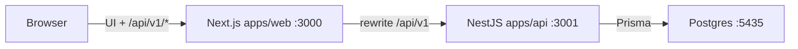
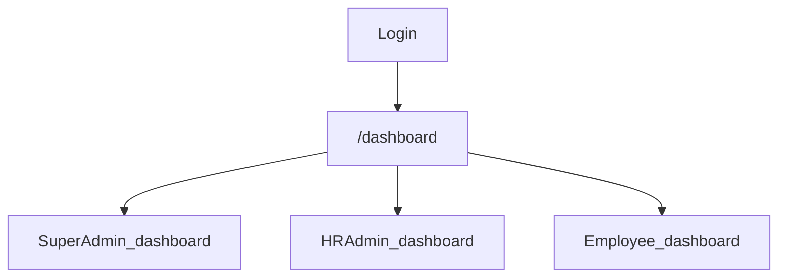
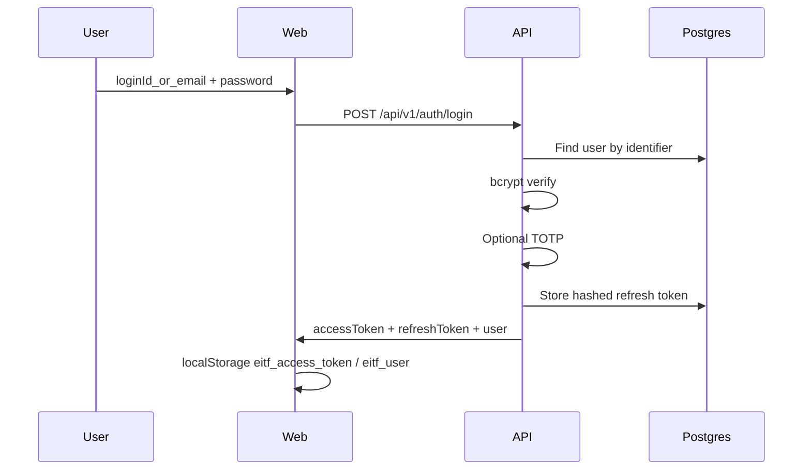
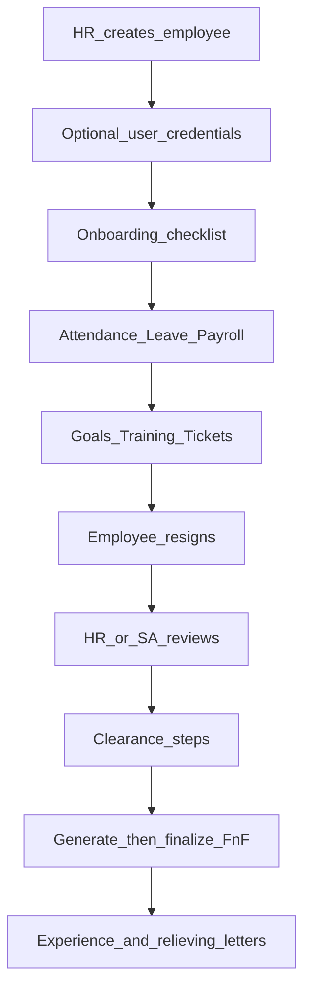
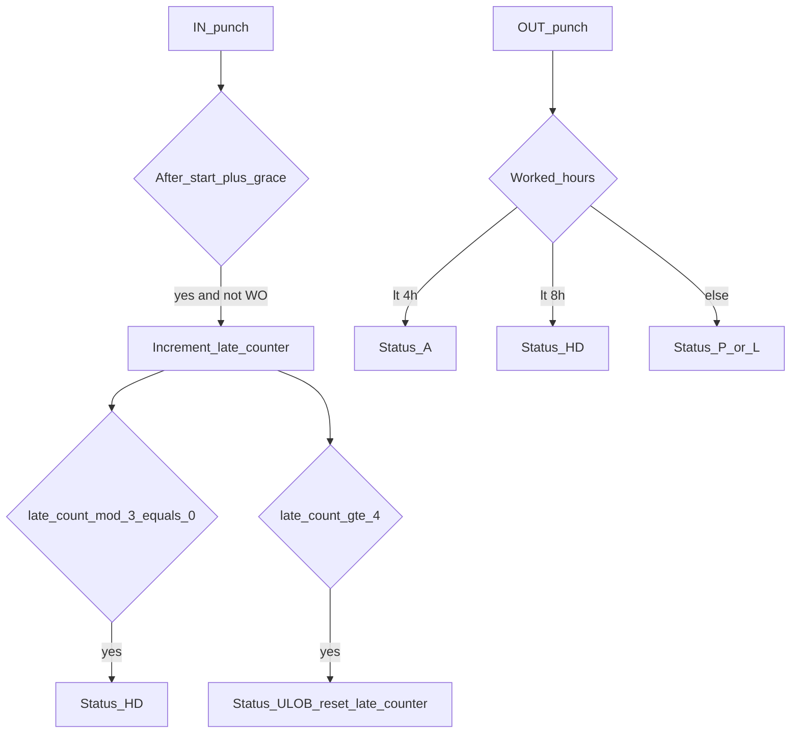
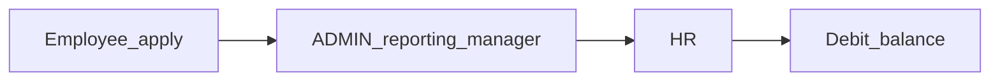
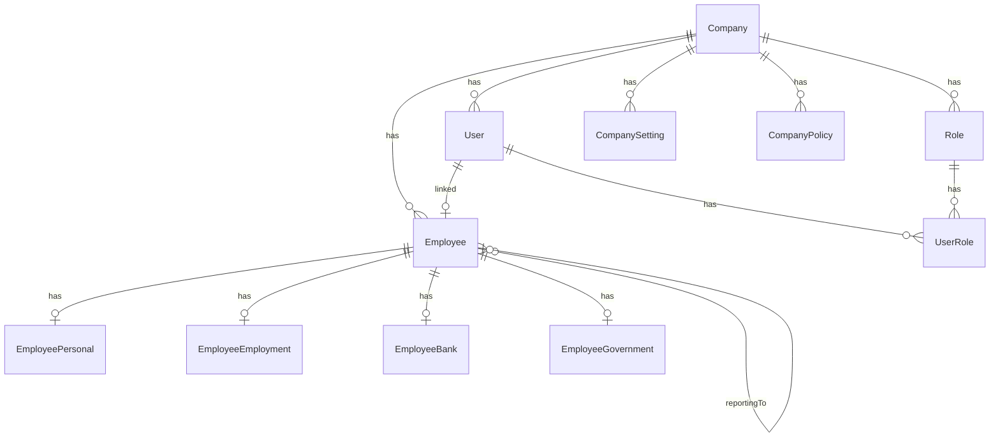
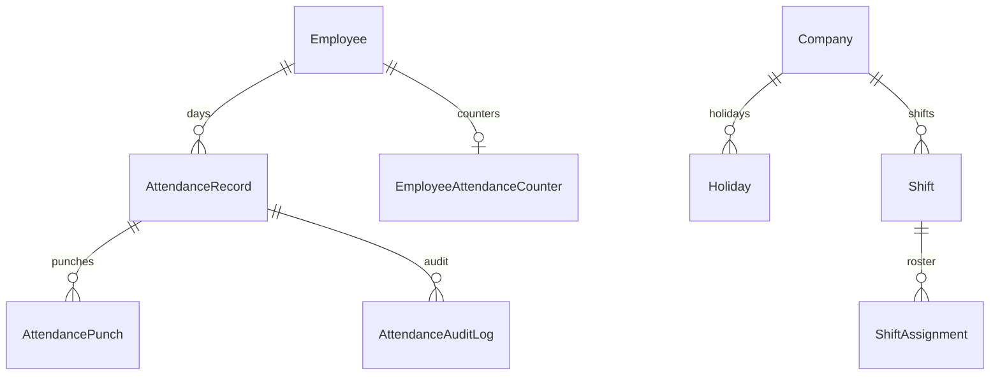
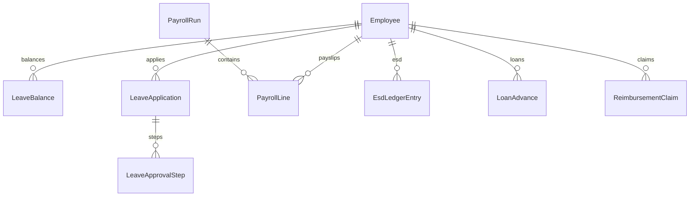

# EITF HRMS — Software Requirements, Operations & Policy Manual

**Document type:** Enterprise product, operations, and company-policy manual  
**Product:** EITF Human Resources Management System (Attendance, Leave, Payroll, Intelligence, Setup)  
**Source of truth:** live implementation at `C:\Users\Aadarsh\Projects\eitf-hrms` (NestJS API, Next.js web, Prisma)  
**Date:** 8 September 2026  
**Status:** Reverse-engineered from code. Not a legal policy issued by HR.

---

## Evidence legend

Every statement in this manual is tagged:

| Tag | Meaning |
|-----|---------|
| **Implemented** | Controller, service, setting, schema, or UI path exists and is reachable in the live product. |
| **Inferred** | Default fallback in code when a setting is missing, or implied by unused-but-stored fields. |
| **Dormant** | Code or schema exists but is not registered, not started, or blocked from the product surface. |
| **Not found** | Requested topic has no implementation. This manual does not invent statutory law or uncoded HR policy. |

**Do not use** `docs/USER_MANUALS.md` as current. That file still describes CEO / MANAGER / FINANCE portals that **do not exist** in `RoleCode`. **Implemented** live roles are only `SUPER_ADMIN`, `ADMIN`, `HR`, `EMPLOYEE`.

---

## 1. Cover, purpose, and runtime

### 1.1 Purpose

This document is the A-to-Z requirements, operations, and policy record of what the HRMS **actually does**. Company rules that live as `CompanySetting` keys are the enforceable policy. Narrative `CompanyPolicy.content` fields are placeholders that tell operators to configure settings.

### 1.2 Runtime topology

**Implemented**

| Layer | Path / binding |
|-------|----------------|
| Web | Next.js 15 — `apps/web` — `http://localhost:3000` |
| API | NestJS 11 — `apps/api` — `http://localhost:3001`, global prefix `api/v1` |
| Swagger | `/api/docs` in non-production only |
| Database | PostgreSQL `eitf_hrms`, embedded local port **5435** (`DATABASE_URL`) |
| Browser → API | Same-origin `/api/v1/*` rewritten by `apps/web/next.config.js` to `127.0.0.1:3001` |
| Start | `npm run db:up` then `npm run start:localhost` (API + web only) |



### 1.3 Monorepo map

**Implemented**

```text
eitf-hrms/
├── apps/api/          Nest API + Prisma schema/migrations/seed
├── apps/web/          Next.js HR portal (live product)
├── apps/orbit/        Former Orbit CRM app — not started by start:localhost
├── apps/mobile/       Expo app — not in root npm workspaces start path
├── scripts/           localhost start, embedded PG, smoke tests
├── docs/              PHASE / deployment notes (may be stale vs code)
└── vendor/            Reference trees
```

**Dormant:** `apps/orbit`, `vendor/orbit-crm`, `apps/api/src/crm` (`CrmModule` is **not** imported in `app.module.ts`).

---

## 2. Company profile

### 2.1 Legal / display names

| Source | Value | Evidence |
|--------|--------|----------|
| Prisma seed | `EITF Enhancing IT Infrastructure Pvt. Ltd.` | **Implemented** — `apps/api/prisma/seed.ts` |
| Studio API | `organization: "Enhance IT Infrastructure (EITF)"` | **Implemented** — `studio.service.ts` |
| `OrganizationSettings.displayName` default | `Enhance IT Infrastructure (EITF)` | **Implemented** — schema |
| Seed placeholders | phone `+91-0000000000`; address/city/state `"To be configured"` | **Implemented** |
| Country / TZ / currency | India, `Asia/Kolkata`, `INR` | **Implemented** — `Company` defaults + seed |

### 2.2 Single organization

**Implemented:** Studio returns `singleOrganization: true` and `companySelector: false`. There is no company-switcher in the web UI. Login resolves the first active company (**Inferred** comment in auth: “defaults to first active company in Phase 1”).

### 2.3 Company record fields

**Implemented** on `Company`: name, legalName, registrationNo, gstin, pan, email, phone, website, address lines, city, state, country, pincode, logoUrl, timezone, currency, isActive.

**Implemented** extras as `CompanySetting` keys (`company.*`): cin, industry, company_type, founded_date, description, branches, contact_numbers, social_links, bank_details, upi, field_visibility.

**Implemented** branding on `OrganizationSettings`: logos as **URL strings** (not file upload), primary/secondary/accent colors (defaults `#1d4ed8` / `#4f46e5` / `#0ea5e9`), darkModeEnabled, dashboardWidgets, sidebarConfig.

Web loads `GET /studio/branding` in `PortalShell` to apply CSS `--brand` and favicon. **Implemented.**

---

## 3. Organizational hierarchy and user panels

### 3.1 Roles

**Implemented** — `RoleCode` enum and `apps/api/src/common/roles.constants.ts`: “Only 4 roles exist.”

| Code | Seed name | Intent in code |
|------|-----------|----------------|
| `SUPER_ADMIN` | Super Admin | Full platform control; payroll generate/approve; reimbursement final review; studio write; AI console write |
| `ADMIN` | Admin | Operational control; leave step 1 if reporting manager; loans review; not payroll generate |
| `HR` | HR | HR operations; leave step 2; employees; attendance corrections; onboarding/exit review |
| `EMPLOYEE` | Employee | Self-service (ESS) |

**Not found:** CEO, MANAGER, FINANCE, CRM_ADMIN as Prisma roles. `isCeo` on the web is an alias of `isSuperAdmin`.

### 3.2 Seed accounts

**Implemented** in `seed.ts` / non-production login hints. Passwords are application seed data, not environment secrets.

| Role | User ID (`loginId`) | Password |
|------|---------------------|----------|
| Super Admin | `superadmin` | `Super@123` |
| Admin | `admin` | `Admin@123` |
| HR | `hr001` | `HR@123` |
| Employee | `emp001` | `Emp@123` |

First install with zero Super Admin users: login page **Initial Super Admin Setup** (`POST /auth/setup/super-admin`). **Implemented.** Copy states no default credentials until setup or seed.

### 3.3 Reporting hierarchy

**Implemented:** `Employee.reportingTo` self-relation. Leave step 1 (`ADMIN`) is allowed only when the actor is the employee’s reporting manager (unless Super Admin or HR). **Implemented** in `leave.service.ts`.

### 3.4 User panels (web)

| Panel | Who sees it | How |
|-------|-------------|-----|
| Admin sidebar | Super Admin, Admin, HR when TopNav **Admin** is selected | `getNavigation(user, 'admin')` |
| Employee sidebar | Pure employees always; admins when TopNav **Employee** is selected | `getNavigation(user, 'employee')` |
| Super Admin dashboard | `SUPER_ADMIN` only | `dashboard/page.tsx` persona `isCeo` |
| HR Admin dashboard | `HR` or `ADMIN` (not Super Admin) | Same file; **ADMIN shares HR layout** |
| Employee dashboard | Users with no admin roles | `/dashboard/employee` API |

**Implemented:** Admin/Employee toggle stored in `sessionStorage` key `eitf-hrms-view-mode:{userId}`. Non-admins are forced to employee mode.

**Inferred mismatch:** `home.ts` has a fourth title “Admin Dashboard” for ADMIN-without-HR; the dashboard page never uses it.



### 3.5 Dashboard contents

**Super Admin — Implemented:** health score; headcount/growth; attendance %; payroll cost; department distribution; hiring (hired / probation / pending onboarding); AI attrition, goal completion, payroll anomalies; risk heatmap; approval inbox; leave calendar; announcements; audit snippet; documents; shortcuts (employees, leave approvals, payroll, assistant, studio, security). APIs include `/dashboard/hr`, `/dashboard/ceo`, AI endpoints.

**HR Admin / ADMIN — Implemented:** active employees, probation, leave queue, onboarding count, payroll anomalies, approvals, recruitment/onboarding, department analytics, calendar, announcements, audit. Shortcuts: employees, attendance, payroll, assistant, documents, assets. No health gauge. AI predictions/performance only if role includes HR.

**Employee — Implemented:** month attendance days; first leave balance; latest payslip; goals+tickets; salary tracker; leave calendar; announcements; own documents. CTAs: mark attendance, apply leave, payslips, assistant, documents.

---

## 4. RBAC permission matrix

### 4.1 Enforcement layers

**Implemented**

1. **API:** global `JwtAuthGuard` → `RolesGuard` (`@Roles` is OR-match; empty `@Roles` = any authenticated user) → `IpAllowlistGuard` → `Require2faGuard`.
2. **API services:** `assertEmployeeScope` / `requireLinkedEmployee` for own-data.
3. **Web:** `getNavigation` sidebar; `canAccessPath` in `PortalShell` (denied → `/dashboard`); per-page redirects; in-page flags.

**Dormant as HTTP enforcement:** `RolePermission` and `UserModuleAccess`. They are stored (`PUT /admin/permissions`, returned on login) and seeded from `DEFAULT_ROLE_MATRIX` in `studio.service.ts`. `RolesGuard` **does not read** these tables. Frontend `moduleAccess` is **never used**.

**Implemented** stored matrix (documentation / Setup UI only unless a specific service checks it — library documents do map FULL for Super Admin/Admin):

| Module key | SUPER_ADMIN | ADMIN | HR | EMPLOYEE |
|------------|-------------|-------|----|----------|
| dashboard | FULL | FULL | FULL | OWN |
| employees | FULL | FULL | FULL | OWN |
| attendance | FULL | FULL | FULL | OWN |
| leave | FULL | FULL | FULL | OWN |
| payroll | FULL | LIMITED | LIMITED | OWN |
| assistant | FULL | FULL | LIMITED | OWN |
| ai-console | FULL | READ | NONE | NONE |
| studio | FULL | READ | NONE | NONE |
| integrations | FULL | READ | NONE | NONE |
| documents | FULL | FULL | DEPARTMENT | OWN |
| import | FULL | FULL | LIMITED | NONE |
| export | FULL | FULL | LIMITED | OWN |
| admin | FULL | LIMITED | NONE | NONE |

### 4.2 Live HTTP matrix (what `@Roles` actually allows)

Legend: V view, C create, E edit, D delete, A approve/review, X export. Blank = no dedicated endpoint for that action. SA = Super Admin.

| Module | SA | ADMIN | HR | EMPLOYEE |
|--------|----|-------|----|----------|
| Company profile GET | V | V | V | public details V |
| Company PUT / logo / settings | VE | — | VE | — |
| Policies GET | V | V | V | V |
| Policies PUT | E | — | E | — |
| Employees list/detail | VE | V | VE | own via `/me` |
| Employees create/status/delete/credentials | CED | — | CED | — |
| Employee payroll-config GET | V | V | V | own V |
| Employee payroll-config PUT | E | — | E | — |
| Attendance self mark / calendar | V C | V C | V C | V C |
| Attendance console / monthly / audit | V | V | V | sheet scoped |
| Attendance manual / correct | CE | — | CE | — |
| Leave apply / withdraw / balances | — | — | — | V C E |
| Leave approvals | VA | VA* | VA | — |
| Leave types seed / accrual / CF / adjust / encash | C | — | C | — |
| Payroll components/templates/generate/approve | VCEDA | — | — | — |
| Payslips | V | V | V | V own approved |
| ESD sheet | V | V | V | own `/esd/:id` |
| Loans apply | — | C | C | C |
| Loans queue review | VA | VA | VA | — |
| Reimbursement submit | — | C | C | C |
| Reimbursement queue | V | — | V | — |
| Reimbursement final review | A | — | — | — |
| Onboarding start/list/tasks | VE | — | VE | own GET |
| Assets list/create/damage | VC | VC | VC | own `/me/assets` |
| Assets allocate/return | CE | — | CE | — |
| Exit list | V | V | V | — |
| Exit resign | — | C | C | C |
| Exit review / docs upload | A | — | A | — |
| F&F generate | C | C | C | — |
| F&F finalize | A | A | — | — |
| Letters | V | V | V | V |
| Performance goals create | C | C | C | V own |
| Self-assessment | — | C | C | C |
| Manager review | C | C | C | — |
| Tickets create | C | C | C | C |
| Tickets status/escalate | E | E | E | — |
| Trainings create/assign | C | — | C | — |
| Workflows config | VE | — | VE | — |
| Approvals pending/act | VA | VA | VA | `/approvals/mine` V |
| Reports / exports | VX | VX | VX | — |
| Security settings/audit/backups | VE X | — | — | — |
| Compliance export | VX | VX | VX | — |
| Studio settings GET | V | V | — | branding JWT |
| Studio settings PUT | E | — | — | — |
| AI chat | C | C | C | C |
| AI console / prompts / settings | VE | V | — | — |
| Admin users create/role/delete | CED | list V | — | — |
| Library documents | VCED | VCED | V C E D | V C E |
| Import jobs | CX | CX | CX | — |
| Export jobs | X | X | X | X |
| Help-docs | V | — | V | — |

\* ADMIN leave approve: only if they are the applicant’s reporting manager, unless also HR/SA. **Implemented.**

### 4.3 Nav vs page mismatches

**Implemented** (document as product defects / undocumented behaviour):

| Path | Nav | Page / `canAccessPath` |
|------|-----|------------------------|
| `/security` | Super Admin + HR | Page Super Admin only; HR redirected |
| `/approvals` | `employee: true` | Page requires SA/HR/ADMIN |
| `/leave/balance-sheet` | Super Admin + HR | Page also allows ADMIN; PortalShell likely blocks ADMIN |
| `/esd` | SA + HR + ADMIN | Page treats ADMIN without `employeeId` as bounce |
| `/trainings` | SA + HR only | Guessing URL may still pass `canAccessPath` via admin route list |
| Help | Employee-nav item | Any signed-in user via `canAccessPath` |
| `/docs/*` | — | Super Admin or HR only |

Admins in Employee **viewMode** still use **admin** routes for `canAccessPath`. **Implemented.** Client redirects are bypassable; APIs must enforce. **Implemented** comment in `middleware.ts`: no JWT at the edge.

---

## 5. Authentication, middleware, protected routes

### 5.1 Login methods

**Implemented**

| Method | Endpoint | Notes |
|--------|----------|-------|
| Password | `POST /auth/login` | Identifier: `loginId`, user email, employee code, work/personal email, or mobile (10+ digits). Legacy field `email` accepted. Optional `totpCode`. Throttle 10/min. |
| Mobile OTP | `POST /auth/otp/request` + `/auth/otp/verify` | OTP hashed SHA-256 in `OtpChallenge`. `SMS_PROVIDER` default `console` — **no real SMS**. Throttle 5/min request, 10/min verify. |
| First Super Admin | `GET /auth/setup/status`, `POST /auth/setup/super-admin` | Public; throttle 3/min on create. |
| Refresh | `POST /auth/refresh` | Opaque token; SHA-256 stored in `RefreshToken`; rotated. Throttle 20/min. |
| Logout | `POST /auth/logout` | JWT |



### 5.2 Tokens and session

**Implemented:** JWT payload `{ sub, companyId, roles }`. bcrypt cost 12.

**Inferred unused env:** Access expiry uses `security.session_timeout_minutes` (default **480**), **not** `JWT_ACCESS_TTL`. `JWT_REFRESH_SECRET` is in `.env.example` but refresh tokens are hashed opaque strings, not JWTs signed with that secret.

Web storage: `localStorage` keys `eitf_access_token`, `eitf_user` (`apps/web/src/lib/api.ts`). **Implemented.**

### 5.3 Security settings (defaults)

**Implemented** in `default-settings.ts`:

| Key | Default |
|-----|---------|
| `security.max_failed_logins` | 5 |
| `security.lockout_minutes` | 30 |
| `security.session_timeout_minutes` | 480 |
| `security.password_min_length` | 5 |
| `security.password_require_upper` | false |
| `security.password_require_number` | false |
| `security.password_require_special` | false |
| `security.require_2fa_for_admins` | false |
| `security.ip_allowlist` | `[]` (all IPs) |
| `security.backup_enabled` | true |
| `security.backup_hour_utc` | 2 |

**Implemented:** Inactive linked employee cannot log in; `forcePasswordChange` redirects to `/account/password`; protected Super Admin cannot be deactivated / role-stripped (`protected-super-admin` helper).

### 5.4 Global guards and middleware

**Implemented** (`app.module.ts` + `main.ts`):

| Layer | Behaviour |
|-------|-----------|
| Throttler | 120 requests / 60s global; stricter on auth routes |
| Helmet | Enabled; CSP off |
| CORS | `CORS_ORIGINS` / `PUBLIC_APP_URL` |
| ValidationPipe | whitelist |
| JwtAuthGuard | Skips `@Public()` |
| RolesGuard | OR `@Roles` |
| IpAllowlistGuard | `security.ip_allowlist` |
| Require2faGuard | If `require_2fa_for_admins`, blocks SA/HR/ADMIN except `/auth/2fa`, `/me`, `/logout`, `/password` |
| Web middleware | Security headers only — **no auth** |

### 5.5 Public API endpoints

**Implemented `@Public()`:** OTP request/verify, setup status/super-admin, login, refresh, `GET /health`, `POST /integrations/biometric/:companyId/webhook`.

### 5.6 2FA

**Implemented:** `POST /auth/2fa/setup` (otplib + QR), `POST /auth/2fa/confirm`. Optional TOTP on password and OTP login when `user.totpEnabled`.

---

## 6. Menus and routes

Sidebar order **Implemented** (`navigation.ts`):

Overview → People → Time & Attendance → Compensation → **Intelligence** → **Setup** → Operations → Insights → Administration → Settings → Support.

| Group | Items (href) |
|-------|----------------|
| Overview | Dashboard `/dashboard`, Analytics `/analytics` |
| People | Employee directory `/employees`, ESS `/ess`, Company Profile `/settings/company`, My Profile `/me/profile`, My Documents `/me/documents` |
| Time & Attendance | Console `/attendance`, Mark `/attendance/mark`, Sheet `/attendance/sheet`, Calendar `/me/attendance/calendar`, Leave apply/approvals/calendar/balance-sheet, Shifts `/shifts`, Holidays `/holidays` |
| Compensation | Payroll `/payroll`, CTC `/payroll/ctc`, Payslips `/payroll/payslips`, ESD `/esd`, Loans `/loans` + queue, Reimbursements `/reimbursements` + queue |
| Intelligence | EITF AI Assistant `/assistant`, AI Console `/ai-console` |
| Setup | Studio `/studio`, Integrations `/integrations`, Documents `/documents`, Import/Export `/import-export`, Admin & Users `/admin/users` |
| Operations | Onboarding, Exit, Performance, Assets, Helpdesk, Notifications, Approval Inbox |
| Insights | Reports, Compliance |
| Administration | Workflows, Training, Security, Audit Logs, Login Activity |
| Settings | Company, Billing |
| Support | Help |

Floating **AiChatWidget** on all signed-in pages. **Implemented.**

**Denied paths — Implemented:** `/crm`, `/crm/*`, `/orbit`, `/sso/orbit`. CRM `page.tsx` files still exist on disk (**Dormant**).

---

## 7. Module catalogue (live features)

### 7.1 Employees

**Implemented:** Directory, create, detail with personal/employment/bank/government/family/emergency, status (`ACTIVE`, `PROBATION`, `NOTICE`, `INACTIVE`, `TERMINATED`, `RESIGNED`), next-code, check-code, credentials reset, username, lock/unlock, delete. Employee documents (HR upload). Payroll config + history + salary tracker. Self profile GET/PUT (`/me/profile`) — limited fields.

### 7.2 ESS

**Implemented:** `/ess` hub; profile; documents (HR-managed uploads; employee download); salary tracker; attendance mark/calendar; leave apply; payslips; loans; reimbursements; assets; tickets; assistant.

### 7.3 Attendance

See §10. UI: console, mark (selfie + GPS + address), sheet, calendar.

### 7.4 Leave

See §11. UI: apply, approvals, calendar, balance sheet.

### 7.5 Shifts

**Implemented:** CRUD, seed defaults, roster, assign, bulk assign, my shift, employee shift-change request, review (SA/HR/ADMIN).

### 7.6 Holidays

**Implemented:** CRUD (SA/HR), employee holiday list, types NATIONAL/FESTIVAL/OPTIONAL/COMPANY, scope ALL/DEPARTMENT/EMPLOYEES. Weekly-off days from settings.

### 7.7 Payroll / CTC / payslips

See §12. UI: payment management, CTC assignment, run detail (approve SA/ADMIN; mark paid includes HR), payslips print.

### 7.8 ESD, loans, reimbursements

**Implemented:** ESD ledger + sheet; loan/advance apply, EMI schedule, recovery, review queue; reimbursement submit + queue (final HTTP review Super Admin only).

### 7.9 Intelligence

**Implemented:** Full-page `/assistant` (history, suggested prompts, regenerate, copy); `/ai-console` (prompts, usage, logs, model — write Super Admin); floating widget; OpenAI if `OPENAI_API_KEY` else rules engine. Resume screening and AI predictions for SA/HR.

### 7.10 Setup

**Implemented:** Studio branding; integrations connect/test (most **stubs**); library documents + versions; CSV/XLSX import (not for pure employees) and export; admin users, permissions UI, devices, force-logout, login logs.

### 7.11 Lifecycle, growth, ops

Onboarding checklists/tasks; assets allocate/return/damage; resignation, clearance, F&F, experience/relieving letters; performance goals, self-assessment, manager review, promotion recommendation; trainings/assignments/certifications; helpdesk tickets + SLA; notifications/announcements; unified approvals; reports; compliance packs; workflows; security/audit/backups; billing **static plans** (hardcoded `'free'`); help + `/docs/:slug` (SA/HR).

---

## 8. Employee lifecycle SOP



**Implemented SOP**

1. Super Admin or HR creates employee (`POST /employees`); optional login; status often `PROBATION`.
2. Super Admin or HR starts onboarding (`POST /onboarding/start`); tasks patched PENDING → DONE.
3. Employee marks attendance, applies leave, views payslips after payroll approve.
4. HR/Admin assign goals/trainings; employee raises tickets.
5. Employee/Admin/HR submit resignation (`POST /exit/resign`) with optional file packet.
6. Super Admin or HR review approve/reject (`POST /exit/:id/review`).
7. Clearance steps (`POST /exit/:id/clearance/:step`); exit interview.
8. F&F generate (SA/ADMIN/HR); finalize (SA/ADMIN only).
9. Letters GET experience / relieving.

**Inferred:** Welcome notification comment “Module 25 later” — not a complete automated welcome campaign.

---

## 9. Role workflows

### 9.1 Employee

Login → Dashboard (ESS metrics) → Mark attendance (selfie+GPS) → Apply leave → Payslips / ESD / loans / claims → Tickets → Assistant. Resign from Exit UI if they have the route; nav Exit is admin-only so employees use ESS/exit APIs or guessed URL — **Inferred** UX gap: `canAccessPath` allows `/exit/*` only for `isAdmin` or HR, so **employees may be blocked from the Exit page** even though `POST /exit/resign` allows EMPLOYEE. **Implemented** mismatch.

### 9.2 HR

Admin sidebar: employees, attendance console/corrections, leave approvals (step 2), holidays/shifts, onboarding, exit review, reports, workflows, notifications. Cannot: payroll generate/approve (**SA only**), reimbursement final review (**SA only**), studio write, AI console write, security page (nav shows HR; **page blocks HR**).

### 9.3 Admin

Leave step 1 if reporting manager; loans review; assets create/damage; F&F generate/finalize; payroll run approve on UI allows ADMIN (`payroll/[id]`) while **API generate/approve is Super Admin only** — **Implemented** UI/API mismatch. Shares HR dashboard layout.

### 9.4 Super Admin (“CEO workflow”)

There is **no CEO role**. The Super Admin dashboard is labelled with CEO APIs (`/dashboard/ceo`). Workflow: studio, AI console, payroll generate/approve, reimbursement approve, security/backups/2FA policy, admin users, integrations connect, audit/login activity, billing screen.

---

## 10. Attendance policies

Defaults **Implemented** in `DEFAULT_COMPANY_SETTINGS` and applied in `attendance.service.ts` (with the same values as service fallbacks unless noted).

### 10.1 Reporting time

| Setting | Default |
|---------|---------|
| `office.work_start` | `10:15` |
| `office.work_end` | `18:30` |
| `office.grace_minutes` | `0` |
| `office.half_day_hours` | `4` |
| `office.full_day_hours` | `8` |

Shift assignment overrides start and grace when present. **Implemented.**

### 10.2 Day statuses

**Implemented** enum `AttendanceDayStatus`: `P` present, `A` absent, `L` late (still paid as present in daily earning), `HD` half-day, `PL` paid leave, `ULOB` unpaid leave of absence, `WO` week-off, `H` holiday, `WFH` work from home, `OD` on duty/official duty.

### 10.3 Punch rules

**Implemented**

- Employee `POST /me/attendance/mark`: enterprise capture requires **selfie + lat/lng + address** for configured methods.
- Methods enabled by default: `MANUAL`, `SELFIE`, `WEB`, `GPS`. QR / geofence / biometric extra.
- Geofence: Haversine vs `attendance.geofence_lat/lng/radius_m` (default radius 200 m; lat/lng 0).
- QR: `attendance.qr_secret`.
- IN after start+grace, not on weekly off → late minutes + counter.
- OUT hours: &lt; 4h → **A**; &lt; 8h → **HD**; else **L** if late else **P**.
- Week-off punch: record status **WO**; late skipped.
- Calendar fill: no punch + holiday → **H**; + week-off → **WO**.
- OT on OUT: minutes beyond schedule; multiplier `attendance.ot_multiplier` **1.5**. Absent/ULOB store **negative** earnings.
- HR `POST /attendance/manual` skips selfie/GPS. `PUT /attendance/:employeeId/:date` corrections (SA/HR) — **this is how WFH/OD are set**. **Inferred:** employees cannot self-mark WFH/OD.

### 10.4 Late → half-day → ULOB

**Implemented**

| Setting | Default | Effect in service |
|---------|---------|-------------------|
| `attendance.late_mark_enabled` | true | Late detection on IN |
| `attendance.late_marks_to_half_day` | 3 | Every 3rd late in window → day status **HD** |
| `attendance.ulob_threshold` | 4 | At 4 lates: `ulobCount++`, late counter reset, day → **ULOB** |
| `attendance.ulob_window_months` | 6 | Rolling window |
| `attendance.ulob_reset_months` | 6 | Counter reset period |
| `attendance.ulob_absent_days` | 2 | **Inferred unused** in services |
| `attendance.late_warning_1` / `_2` | `warning` | **Inferred unused** in services |



### 10.5 Week-offs and holidays

**Implemented:** `weekly_off.days` default `[0]` (Sunday). `Holiday` master. Calendar treats week-off and holiday when no punch.

`weekly_off.paid_saturday` and `weekly_off.extra_day_pay_on_work` are **stored**. Extra-day pay is applied in `calcDailyEarning` when `workedOnWeekOff` is passed (**Implemented** helper). Wiring into payroll generate is **Inferred** / partial.

### 10.6 Incentive (attendance)

**Implemented** defaults: enabled, amount **500**, `max_late_marks` **0** (zero lates). Eligibility function checks late count vs max. Flags `require_no_half_day`, `require_no_absent`, `require_no_ulob` are **true in settings** but **Inferred unused** in `incentiveEligibility`.

### 10.7 Biometric

**Implemented:** public webhook `POST /integrations/biometric/:companyId/webhook`. Comment: protect with device secret later — **no secret check**. **Dormant** hardening.

---

## 11. Leave policies

### 11.1 Types (seeded)

**Implemented** `ensureDefaultTypes`:

| Code | Name | Extra |
|------|------|-------|
| CL | Casual Leave | |
| SL | Sick Leave | requires attachment |
| EL | Earned Leave | carry-forward target |
| CO | Comp Off | paid; skip insufficient-balance check |
| OTHER | Other | note required; skip insufficient-balance check |

### 11.2 Accrual

**Implemented** (`runMonthlyAccrual` — **HTTP** `POST /leave/accrual/run`, not Nest cron):

| Setting | Default |
|---------|---------|
| `leave.probation_months` | 6 — 0 credit during this period |
| `leave.credit_at_probation_end` | 6 days |
| `leave.monthly_credit_after` | 1 day / month |
| `leave.carry_forward_enabled` | true |
| `leave.carry_forward_max` | 999 in settings; service fallback **12** if missing — **Inferred** conflict |
| `leave.expire_enabled` | false |

Balance formula **Implemented:** `opening + accrued + CF + adjusted − used − encashed`.

### 11.3 Apply / withdraw

**Implemented:** `POST /me/leave/apply` — date range, optional half-day (0.5), attachment, approval required. Withdraw before final approval. OTHER/CO skip insufficient balance.

### 11.4 Approval chain

**Implemented** default chain name `default`: step 1 `ADMIN` (reporting manager), step 2 `HR`. Super Admin and HR may act on any pending step. Final approve debits balance and writes ledger.



---

## 12. Payroll rules

Statutory Indian PF 12% / TDS slabs / ESIC are **Not found** as engines. Amounts are **per-employee JSON config** plus company ESD/incentive settings.

### 12.1 Components (catalog)

**Implemented** examples: BASIC, HRA, SPECIAL, INCENTIVE, REIMB, PF, PT, ESD, LOAN_EMI, LOP, ASSET_DAMAGE.

### 12.2 Employee payroll config defaults

**Implemented** `defaultPayrollConfigJson()`:

| Item | Default |
|------|---------|
| Allowances | basic, hra, medical, travel, internet, overtime, bonus, incentive, special, custom[] — all 0 |
| PF | disabled; mode **fixed**; value **3600** |
| TDS | disabled; mode **percent**; value **1** (% of gross when enabled) |
| ESD | disabled; amount **500** |
| Professional tax | disabled; amount 0 |
| Custom deductions | [] |

Company ESD: `esd.enabled` true, `esd.monthly_amount` 500, `esd.interest_rate_annual` 0. **Implemented.**

### 12.3 Generate run (Super Admin)

**Implemented** (`payroll.service.ts`): for each active employee, merge payroll config or salary structure → attendance present/LOP → LOP on BASIC → optional incentive → ESD → loan EMIs → asset damage → reimbursements → gross − deductions = net.

**LOP — Implemented:** `(basic / calendarDaysInMonth) * (A + ULOB + 0.5×HD)`. Present for LOP purposes: P, PL, WFH, OD.

**Daily earning helper — Implemented:** P/WFH/OD/L/PL = full daily; HD = half; A/ULOB = −daily; H = daily unless `holidayPaid === false`; WO worked = 2× daily if `workedOnWeekOff`.

Runs: **DRAFT** until Super Admin `POST /payroll/runs/:id/approve` (locks; posts ESD/loan side-effects). Cannot regenerate APPROVED/LOCKED. Payslips: employee sees APPROVED/LOCKED lines only.

**UI note:** payroll detail allows ADMIN to click approve; API generate/approve is **SUPER_ADMIN only**. **Implemented** mismatch.

### 12.4 Related money

ESD ledger DEPOSIT + simple monthly interest. Loans ACTIVE EMI deducted. Reimbursements added then marked paid on payroll approve. Asset damage charges deducted.

---

## 13. Company rules, regulations, and SOPs

### 13.1 Stored policy documents

**Implemented** `DEFAULT_POLICIES` — these are **not** detailed legal text:

| Code | Title | Content (verbatim intent) |
|------|-------|---------------------------|
| attendance | Attendance Policy | Configure via Company Settings. Late marks and ULOB thresholds are applied automatically. |
| leave | Leave Policy | Leave accrues per company settings. First probation period credits 0 until configured threshold. |
| payroll | Payroll Policy | Payroll runs are draft until approved; approved payslips are immutable. |

HR/SA may edit via `PUT /company/policies/:code`.

### 13.2 Operational SOPs (from screens)

**SOP — Employee attendance**

1. Open `/attendance/mark`.
2. Allow camera and GPS; fill address.
3. IN then later OUT. Late/ULOB apply automatically.

**SOP — Leave**

1. `/leave/apply` → type, dates, half-day, attachment if SL.
2. Manager (ADMIN reporting-to) then HR.
3. Withdraw from My applications if still pending.

**SOP — Payroll (Super Admin)**

1. Ensure CTC / payroll-config and attendance sheet for the month.
2. `/payroll` generate (SA API).
3. Review lines; approve to lock and post ESD/loans.
4. Employees open `/payroll/payslips`.

**SOP — Exit**

1. Resignation + documents.
2. HR/SA review.
3. Clearance + interview.
4. Generate F&F then SA/ADMIN finalize.
5. Print letters.

### 13.3 Field visibility

**Implemented** setting `company.field_visibility` JSON — controls which company profile fields employees see. Exact keys depend on the company settings UI.

---

## 14. Approval workflows

**Implemented** enum `WorkflowType`: `LEAVE`, `LOAN`, `ADVANCE`, `EXPENSE`, `SALARY`, `RESIGNATION`.

Configurable in `/workflows` (SA/HR) as JSON steps; instances in `/approvals` (SA/HR/ADMIN). Statuses: PENDING, APPROVED, REJECTED, CANCELLED. Actions: APPROVE, REJECT, COMMENT.

Domain HTTP reviewers (may differ from workflow JSON):

| Domain | HTTP who can complete |
|--------|------------------------|
| Leave | ADMIN (reporting manager) then HR; SA/HR any step |
| Loan / advance | SA, HR, ADMIN (`isFinance`) |
| Reimbursement | Workflow: HR then SUPER_ADMIN; **HTTP review Super Admin only** |
| Salary revision | Workflow HR then SUPER_ADMIN; payroll HTTP SA |
| Resignation | SA, HR |
| Shift change | SA, HR, ADMIN |

---

## 15. Validations and business logic notes

**Implemented**

- DTO `ValidationPipe` whitelist on API.
- Employee mark: selfie + GPS + address when enterprise capture applies.
- Password: min length 5; complexity flags default off.
- Login lockout after 5 failures for 30 minutes.
- File uploads: employee/library/exit **15 MB**; import CSV **8 MB**.
- Leave SL requires attachment flag; OTHER requires note.
- Payroll deductions capped at gross+allowances; net ≥ 0.

---

## 16. Database structure

Postgres via Prisma. Tenant root: `Company` (single live org).

### 16.1 Identity



### 16.2 Time



### 16.3 Leave and payroll



### 16.4 Model list (all Prisma models)

**Identity:** Company, CompanySetting, CompanyPolicy, Role, User, UserRole, UserModuleAccess, RefreshToken, OtpChallenge, AuditLog, LoginSession, LoginLog, UserDevice, RolePermission, OrganizationSettings  

**Employee:** Employee, EmployeePersonal, EmployeeEmployment, EmployeeBank, EmployeeGovernment, EmployeeFamilyMember, EmployeeEmergencyContact, EmployeeStatusHistory, DocumentType, EmployeeDocument  

**Time:** Holiday, Shift, ShiftAssignment, ShiftChangeRequest, AttendanceRecord, AttendancePunch, AttendanceAuditLog, EmployeeAttendanceCounter, BiometricDevice  

**Leave:** LeaveType, LeaveBalance, LeaveApplication, LeaveApprovalStep, LeaveLedgerEntry, LeaveApprovalChain  

**Payroll:** SalaryComponent, SalaryTemplate, SalaryTemplateLine, EmployeeSalaryStructure, EmployeeSalaryLine, EmployeePayrollConfig, SalaryRevision, PayrollRun, PayrollLine, EsdLedgerEntry, LoanAdvance, LoanEmiSchedule, LoanRecoveryEntry, ReimbursementClaim  

**Lifecycle:** OnboardingChecklist, OnboardingTask, Asset, AssetAllocation, AssetDamageCharge, Resignation, ExitClearanceItem, FnfSettlement  

**Growth:** PerformanceGoal, SelfAssessment, ManagerReview, PromotionRecommendation, Training, TrainingAssignment, Certification, TicketSlaConfig, Ticket, TicketComment  

**Comms:** Notification, NotificationTemplate, Announcement, NotificationDispatchLog, DashboardMetricsCache  

**Workflow:** ApprovalWorkflow, ApprovalChainStep, ApprovalInstance, ApprovalAction  

**Ops / Intelligence:** BackupRun, IntegrationConfig, IntegrationEventLog, IntegrationApiKey, LibraryDocument, LibraryDocumentVersion, ImportJob, ExportJob, AiChatMessage, ResumeScreening, AiConversation, AiMessage, AiPrompt, AiLog, AiUsage  

**Dormant CRM:** CrmCustomer, CrmLead, CrmDeal, CrmFollowUp, CrmNote, CrmTask, CrmTaskComment, CrmActivityLog  

---

## 17. API catalog

Base: `/api/v1`. JWT unless marked Public.

### Auth — prefix `auth`

| Method | Path | Access |
|--------|------|--------|
| POST | `/auth/otp/request` | Public, 5/min |
| POST | `/auth/otp/verify` | Public, 10/min |
| GET | `/auth/setup/status` | Public |
| POST | `/auth/setup/super-admin` | Public, 3/min |
| POST | `/auth/login` | Public, 10/min |
| POST | `/auth/refresh` | Public, 20/min |
| POST | `/auth/logout` | JWT |
| GET | `/auth/me` | JWT |
| POST | `/auth/2fa/setup` | JWT |
| POST | `/auth/2fa/confirm` | JWT |
| POST | `/auth/password/change` | JWT |
| POST | `/auth/username/change` | JWT |
| GET/POST | `/auth/admin-users` | SA |
| DELETE | `/auth/admin-users/:id` | SA |

### Admin — prefix `admin` (class SA unless noted)

Users CRUD/activate/deactivate/reset-password/role/permanent-delete; permissions GET (SA+ADMIN) PUT (SA); devices; force-logout; login-logs; login-sessions.

### Company — prefix `company`

GET `/company` SA/HR/ADMIN; GET `/company/details` JWT; PUT company/logo SA/HR; settings GET SA/HR; settings/public JWT; PUT settings SA/HR; policies GET JWT; PUT policies/:code SA/HR.

### Employees (no prefix)

List/create/next-code/check-code/:id GET/PUT/status/credentials/login-info/username/lock/unlock/DELETE; `/me/profile`, `/me/salary-tracker`; payroll-config GET/PUT; payroll-history; salary-tracker.

### Documents / library

Document-types; employee documents CRUD + download/view/replace; `/me/documents`; `/library/documents` CRUD + versions + download/preview.

### Holidays

GET/POST `/holidays`; PUT/DELETE `/holidays/:id` SA/HR; GET `/me/holidays` JWT; GET `/employees/:employeeId/holidays` SA/HR/ADMIN.

### Shifts

GET `/shifts`; POST seed-defaults/create; PUT `/shifts/:id`; GET roster; POST assign / assign/bulk; GET `/me/shift`; POST `/me/shift-change`; GET `/shift-changes`; POST `/shift-changes/:id/review`.

### Attendance

POST `/me/attendance/mark`; GET `/me/attendance/summary`, `/me/attendance/calendar`; GET `/attendance/console`, `/monthly`, `/sheet`, `/records/:employeeId/:date`, `/audit`, `/counters`, `/biometric-devices`, `/team`; POST `/attendance/manual`; PUT `/attendance/:employeeId/:date`; POST `/integrations/biometric/:companyId/webhook` **Public**.

### Leave

GET `/leave/types`; POST `/leave/types/seed`; GET `/me/leave/balances`, `/employees/:employeeId/leave/balances`; POST `/me/leave/apply`; GET `/me/leave/applications`; PUT withdraw; GET `/leave/approvals`; POST `/leave/approvals/:id/review`; GET `/leave/calendar`, `/leave/balance-sheet`; POST `/leave/accrual/run`, `/leave/carry-forward/run`, `/leave/adjust`, `/leave/encash/:employeeId`; GET ledger.

### Payroll

GET/POST `/salary/components`, `/salary/templates` SA; POST `/salary/structures` SA; GET structures/revisions; GET `/payroll/runs`, `/payroll/runs/:id` SA; POST `/payroll/generate`, `/payroll/runs/:id/approve`, `/payroll/lines/:id/paid` SA; GET `/payroll/my-payslips` (+ `/:id`); ESD sheet and `/:employeeId`; POST `/loans`; GET `/loans/mine`, `/loans/queue`, `/loans/sheet`; POST `/loans/:id/review`; POST `/reimbursements`; GET mine/queue; POST `/reimbursements/:id/review` **SA only**.

### Lifecycle, growth, aggregation, workflow

Onboarding start/list/get/task patch; assets CRUD allocate/return/damage; `/me/assets`; exit resign/list/get/review/clearance/interview/documents/fnf/letters. Growth: goals, self-assessment, manager review, trainings, tickets + SLA run. Aggregation: `/me*` ESS, `/dashboard/employee|hr|ceo`, notifications send/announcements/wishes. Workflow: config, pending, history, act, `/approvals/mine`.

### Reports and security

GET reports by kind; export excel/pdf/csv; email stub; balance-sheets same. Prefix `security`: settings GET/PUT, audit, backups **SA**; compliance + exports SA/HR/ADMIN.

### Integrations, AI, studio, data-exchange, help, health

Integrations connect/disconnect/test/keys/send/calendar/accounting/devices as in §4. AI: chat/history JWT; prompts/settings SA; resume/predictions SA/HR; anomalies/insights SA/HR/ADMIN. Studio branding JWT; settings GET SA/ADMIN; PUT SA. Import templates/jobs SA/ADMIN/HR; export also EMPLOYEE. GET `/help-docs/:slug` SA/HR. GET `/health` Public.

### CRM — prefix `crm`

**Dormant:** controller exists; `CrmModule` not in `AppModule`. Routes are not served.

---

## 18. Notifications, reports, exports, uploads, audit

### 18.1 Notifications

**Implemented:** in-app `Notification`, templates WELCOME/BIRTHDAY/ANNIVERSARY/GENERIC, announcements, `POST /notifications/wishes/run`. Email/SMS/WhatsApp/Push logged as `STUB_SENT`. **Dormant** real send.

### 18.2 Reports

**Implemented** kinds: attendance, leave, payroll, employee, department, cost, compliance, audit, performance, reimbursement(s), asset(s), exit, esd.

Balance sheets: leave, salary, deposit, loan, advance, overtime (proxy), incentive, fnf.

Formats: CSV, Excel (ExcelJS), HTML-as-PDF. Email export **stub**.

Compliance UI kinds: pf, esic, pt, lwf, tds, form16, form24q, salary_register, attendance_register, salary, deposit, reimbursement, asset, leave, payroll — **Implemented** as export packs; **not** a statutory filing engine.

### 18.3 Uploads

**Implemented** local disk `LOCAL_STORAGE_DIR` or `cwd/uploads`. Surfaces: library documents, import files, employee documents, exit packet. Studio logos are URLs. `me/documents` download-only. Reimbursements/tickets: **no** receipt file field. **Inferred:** `S3_*` env only labels provider; `save()` writes local.

### 18.4 Audit

**Implemented:** `AuditLog` actions CREATE/UPDATE/DELETE/LOGIN/LOGOUT/LOGIN_FAILED/PASSWORD_RESET/PERMISSION_CHANGE/SETTINGS_CHANGE/OTHER. Separate `AttendanceAuditLog`. LoginSession, LoginLog, UserDevice. Security CSV export. Reports `/reports/audit`.

---

## 19. Integrations and environment

### 19.1 Providers

**Implemented** enum: EMAIL, SMS, WHATSAPP, BIOMETRIC_ESSL, GOOGLE_CALENDAR, ACCOUNTING, GMAIL, OUTLOOK, SLACK, TEAMS, GOOGLE_DRIVE, ONEDRIVE, REST_API, WEBHOOK.

Connect/test/send/calendar/accounting mostly return `{ stub: true }`. Secrets encrypted with `INTEGRATION_SECRET_KEY` or JWT secret. **Implemented** storage; **Dormant** live delivery except biometric punch ingest.

### 19.2 Environment variable **names** (no secret values)

From `.env.example` **Implemented** as declared: `POSTGRES_*`, `REDIS_PORT`, `DATABASE_URL`, `REDIS_URL`, `JWT_ACCESS_SECRET`, `JWT_REFRESH_SECRET`, `JWT_ACCESS_TTL`, `JWT_REFRESH_TTL`, `OTP_TTL_SECONDS`, `OTP_LENGTH`, `API_PORT`, `API_PREFIX`, `CORS_ORIGINS`, `S3_ENDPOINT`, `S3_BUCKET`, `S3_ACCESS_KEY`, `S3_SECRET_KEY`, `S3_REGION`, `SMS_PROVIDER`, `EMAIL_PROVIDER`, `NEXT_PUBLIC_API_URL`.

Used in API code, not all in example: `NODE_ENV`, `LOCAL_STORAGE_DIR`, `OPENAI_API_KEY`, `OPENAI_MODEL`, `AI_SYSTEM_PROMPT`, `INTEGRATION_SECRET_KEY`, setup bootstrap vars.

**Inferred unused/weak:** `JWT_ACCESS_TTL` (session minutes used instead); `JWT_REFRESH_SECRET`; S3 upload; `REDIS_URL` (health check only; throttler in-memory); `EMAIL_PROVIDER` still stub.

Production example also names `PUBLIC_APP_URL`, ports, Cloudflare tunnel token, backup interval/retention, load-test user/pass — **do not copy values from `.env` files**.

---

## 20. Production-readiness, limitations, undocumented features

### 20.1 Production checklist (from code, not a passed audit)

| Item | State |
|------|--------|
| HTTPS / reverse proxy | Operator concern; not in app |
| Change JWT secrets | Required |
| CORS locked to real origin | Required |
| `require_2fa_for_admins` | Default **false** |
| IP allowlist | Default empty |
| Password complexity | Default off; min length 5 |
| Biometric webhook auth | **Missing** |
| Real SMS/email | **Stubs** |
| S3 uploads | **Not implemented** |
| Prisma migrate on existing DB | `migrate deploy` can fail P3005; team used `db push` |
| CRM | Schema leftover; module off; web blocked |
| Redis | Not used for sessions/throttle |
| Rate limit | In-memory Throttler (not shared across API replicas) |
| Client-only route guard | Bypassable; rely on API |

### 20.2 Known limitations

- Four roles only; stale docs mention CEO/Manager/Finance.
- `RolePermission` UI without guard enforcement.
- Payroll SA-only vs ADMIN approve button.
- Reimbursement HR cannot HTTP-approve.
- Employee Exit page likely blocked by `canAccessPath`.
- Accrual, carry-forward, wishes, SLA, backups: **HTTP-triggered**, not in-process cron in this tree.
- PF/TDS/PT/ESIC compliance screens are data packs, not government filings.
- Billing page is a static catalogue with plan hardcoded `'free'` (Orbit leftover copy mentioning CRM).
- `RequireRoles` React component unused.
- Duplicate `RoleCode.ADMIN` in some `@Roles` lists (noise).

### 20.3 Undocumented features found in code

- Intelligence + Setup sidebar groups and Studio/AI/library/import modules (newer than `PROJECT-HANDOVER.md`).
- Floating AI widget for all signed-in users.
- Attendance incentive and ULOB counters.
- ESD interest setting (annual rate, default 0).
- Library document versioning.
- Force-logout and device list (Super Admin).
- Resume screening AI endpoints.
- Public first-user Super Admin setup.
- Geofence/QR attendance methods behind settings.
- `calcDailyEarning` double-pay on worked week-off.
- Help markdown `GET /help-docs/:slug` (404 if file missing).
- CRM Prisma models and unmounted controller.
- Orbit SSO page still on disk, always denied.

---

## Appendix A — Registered Nest modules

`Prisma`, `Audit`, `Auth`, `Company`, `Employees`, `Documents`, `Holidays`, `Shifts`, `Attendance`, `Leave`, `Payroll`, `Lifecycle`, `Growth`, `Aggregation`, `Workflow`, `Reports`, `Security`, `Integrations`, `Ai`, `Admin`, `HelpDocs`, `Studio`, `DataExchange`, `Health`.

Global: `AllExceptionsFilter`, `ThrottlerGuard`, `JwtAuthGuard`, `RolesGuard`, `IpAllowlistGuard`, `Require2faGuard`.

---

## Appendix B — Web pages (65)

Live product routes listed in §6 plus: `/account/password`, `/analytics`, `/admin/login-activity`, `/ai-console`, `/assistant`, `/billing`, `/compliance`, `/docs/[slug]`, `/employees/[id]`, `/exit/[id]/letters`, `/help`, `/import-export`, `/payroll/[id]`, `/payroll/payslips/[id]`, `/security/audit`, `/studio`.

**Dormant pages:** `/crm/*`, `/sso/orbit`.

---

*End of manual. Regenerated from source; if settings in the database differ from `DEFAULT_COMPANY_SETTINGS`, the database values win at runtime.*
