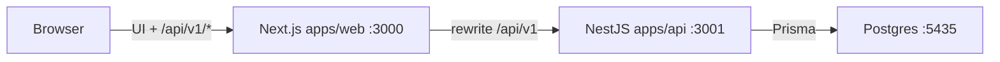
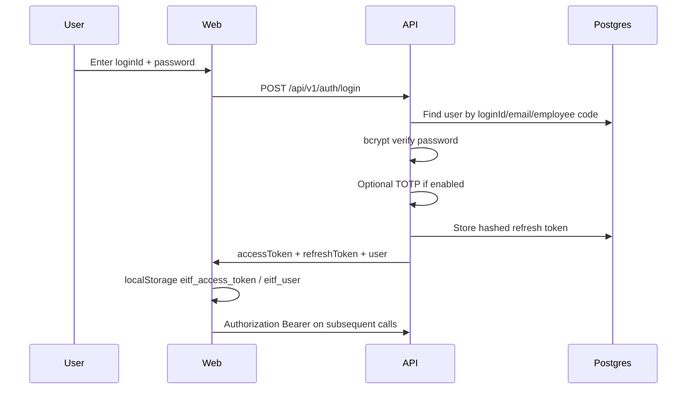
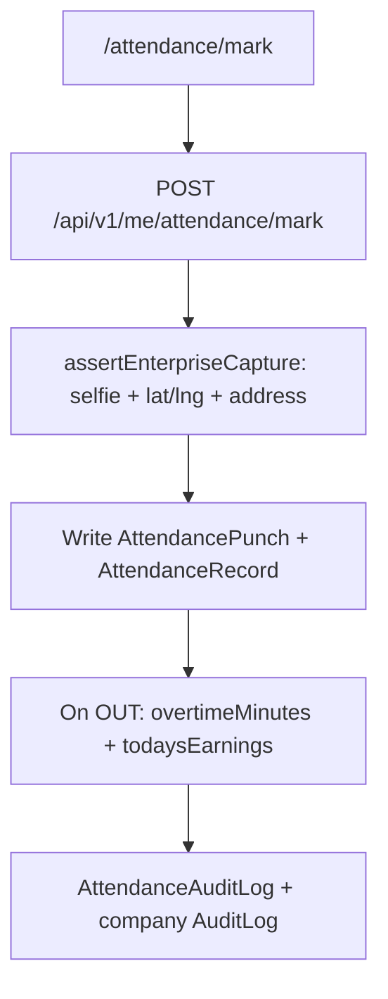

# EITF HRMS & Payroll — Project Handover

**Document type:** Product + engineering handover  
**Repository:** `C:\Users\Aadarsh\Projects\eitf-hrms`  
**Product focus:** HR Attendance, Leave, Payroll, and core HR operations  
**Last updated:** 2026-09-07  

---

## 1. Executive summary

**EITF HRMS** is an enterprise Human Resources Management System for attendance, leave, payroll, employees, and related HR operations. It is a monorepo with:

| Layer | App | Role |
|--------|-----|------|
| Frontend | `apps/web` | Next.js 15 portal (admin + employee self-service) |
| Backend | `apps/api` | NestJS 11 REST API + Prisma |
| Database | Embedded Postgres (dev) | Port **5435**, database `eitf_hrms` |
| Dormant | `apps/orbit`, `apps/api/src/crm` | Former CRM merge artifacts — **not started / not registered** |

**Current product stance:** CRM was removed from the live product surface (sidebar, Nest `CrmModule`, Orbit proxy). The application focuses on **HR Attendance & Payroll**. CRM code/schema may still exist in the tree for historical reasons but is inactive.

| Service | URL / Port |
|---------|------------|
| Web (public) | http://localhost:3000 |
| API | http://localhost:3001/api/v1 |
| Swagger | http://localhost:3001/api/docs (if enabled) |
| Embedded Postgres | localhost:**5435** |

---

## 2. Roles and seed accounts

### Role codes

Defined in `apps/api/src/common/roles.constants.ts`:

| Code | Intent |
|------|--------|
| `SUPER_ADMIN` | Full platform control |
| `ADMIN` | Operations admin (approvals, limited HR ops) |
| `HR` | HR operations (attendance, leave, employees) |
| `EMPLOYEE` | Self-service (ESS) |

### Seed logins

From `apps/api/prisma/seed.ts` (after `npm run db:seed`):

| Role | User ID (`loginId`) | Email | Password |
|------|---------------------|-------|----------|
| Super Admin | `superadmin` | superadmin@company.com | `Super@123` |
| Admin | `admin` | admin@company.com | `Admin@123` |
| HR | `hr001` | hr001@company.com | `HR@123` |
| Employee | `emp001` | emp001@company.com | `Emp@123` |

Login accepts **User ID or email** (field `identifier` on the web form).

---

## 3. Architecture and technical flow

### 3.1 Runtime topology



- Browser calls **same origin** `/api/v1/*`.
- Next.js rewrites `/api/v1/:path*` → `http://127.0.0.1:3001/api/v1/:path*` (`apps/web/next.config.js`).
- Nest global prefix: `api/v1` (`apps/api/src/main.ts`).
- Dev entry: `npm run start:localhost` → API + web only (`scripts/start-localhost.mjs`). Orbit is **not** started.

### 3.2 Authentication flow



**Guards (global, `app.module.ts`):** Throttler → `JwtAuthGuard` → `RolesGuard` → `IpAllowlistGuard` → `Require2faGuard`.

- JWT payload: `{ sub, companyId, roles }`.
- `@Public()` skips JWT (e.g. biometric webhook).
- `@Roles(...)` = any-of role match; no `@Roles` = any authenticated user.
- Self-vs-admin scoping helpers: `isPrivileged`, `assertEmployeeScope`, `requireLinkedEmployee` (`apps/api/src/common/authorization.util.ts`).

### 3.3 Attendance mark flow (employee)



---

## 4. Stack and repository map

### 4.1 Versions

| Package | Stack |
|---------|--------|
| Root | npm workspaces; Node `>=20` |
| `apps/api` | NestJS ^11, Prisma ^6, JWT/Passport, TypeScript ^5.7 |
| `apps/web` | Next.js ^15.1, React ^19, Tailwind ^3.4 |
| `apps/orbit` | Next 14.2.5 + Prisma 5 (dormant; not in localhost start) |

### 4.2 Top-level layout

```text
eitf-hrms/
├── apps/
│   ├── api/          # Nest API + Prisma schema/migrations/seed
│   ├── web/          # Next.js HR portal
│   ├── orbit/        # Former Orbit CRM app (not started by default)
│   └── mobile/       # Expo app (exists; not in root workspaces)
├── scripts/          # start-localhost, embedded PG, smoke/load tests
├── docs/             # PHASE docs, deployment, security, training
├── data/             # Embedded PG data (local)
├── vendor/           # Reference/vendor trees
└── PROJECT-HANDOVER.md  # This document
```

### 4.3 Sidebar navigation (live product)

From `apps/web/src/lib/navigation.ts`:

| Group | Modules |
|-------|---------|
| Overview | Dashboard, Analytics |
| People | Employees, ESS, Company Profile, My Profile, Documents |
| Time & Attendance | Attendance console / mark / sheet / calendar, Leave, Shifts, Holidays |
| Compensation | Payroll runs / CTC / payslips, ESD, Loans, Reimbursements |
| Operations | Onboarding, Exit, Performance, Assets, Helpdesk, Notifications, Approvals |
| Insights | Reports, Compliance |
| Administration | Workflows, Integrations, Training, Security, Audit, Login Activity, User Control |
| Settings | Company, Billing |
| Support | Help |

**CRM paths denied** in `canAccessPath` (`/crm`, `/orbit`, `/sso/orbit`). Legacy CRM URLs redirect to `/dashboard` or HR equivalents (`next.config.js`).

---

## 5. Business logic (core domains)

### 5.1 Attendance

**Code:** `apps/api/src/attendance/` (`attendance.controller.ts`, `attendance.service.ts`, DTOs)  
**Schema:** `AttendanceRecord`, `AttendancePunch`, `AttendanceAuditLog`, `EmployeeAttendanceCounter`, `BiometricDevice`

| Capability | Behavior |
|------------|----------|
| Self mark | `POST me/attendance/mark` — requires selfie + GPS lat/lng + address (`requireGps: true`) |
| Methods | MANUAL, QR, GPS, GEOFENCE, SELFIE, WEB, BIOMETRIC (company settings) |
| Geofence | Haversine vs configured lat/lng/radius |
| QR | Validated with company QR secret |
| HR manual | `POST attendance/manual` — skips selfie/GPS |
| Correct | `PUT attendance/:employeeId/:date` (SUPER_ADMIN/HR) |
| Console | `GET attendance/console?date=` — day roster |
| Monthly | `GET attendance/monthly` |
| Sheet | `GET attendance/sheet` — in/out, locations, OT, earnings, selfie/maps |
| Calendar | `GET me/attendance/calendar` — statuses + holidays/week-offs |
| OT / earnings | On check-out: overtime after threshold; pay via multiplier + daily earning by status |
| Late → ULOB | Counter thresholds → half-day / unpaid leave of absence style deductions |
| Audit | `AttendanceAuditLog` + `GET attendance/audit` |
| Biometric | Public webhook `POST integrations/biometric/:companyId/webhook` |

**Web UI:** `/attendance`, `/attendance/mark`, `/attendance/sheet`, `/me/attendance/calendar`

### 5.2 Leave

**Code:** `apps/api/src/leave/`

| Capability | Behavior |
|------------|----------|
| Types | Configurable leave types; seed endpoint for defaults |
| Apply | `POST me/leave/apply` — balance checks; optional attachment; approval chain |
| Approvals | Multi-step (`LeaveApprovalChain`, default ADMIN → HR); last approve debits balance |
| Withdraw | Employee withdraw before final approval |
| Calendar | Filtered by date/department/status |
| Balance sheet | Yearly balances for HR/Admin |
| Ops | Accrual run, carry-forward, adjust, encash, ledger |

**Web UI:** `/leave/apply`, `/leave/approvals`, `/leave/calendar`, `/leave/balance-sheet`

### 5.3 Payroll

**Code:** `apps/api/src/payroll/` (`payroll.service.ts`, `payroll-calculator.ts`)  
**Also:** `employees/.../payroll-config` via `employee-payroll.service.ts`

| Capability | Behavior |
|------------|----------|
| Components / templates | Salary component catalog and templates |
| Structures / CTC | Annual CTC + lines; revisions history |
| Generate run | Per active employee: payroll config **or** salary structure → attendance present/LOP → LOP on BASIC → optional incentive → ESD → loan EMIs → asset damage → reimbursements → gross − ded = net |
| Approve | Locks run; posts ESD/loan side-effects |
| Payslips (ESS) | Employee sees APPROVED/LOCKED lines only |
| Related money | ESD ledger, loans/EMI, reimbursement claims |

**Web UI:** `/payroll`, `/payroll/ctc`, `/payroll/payslips`, `/esd`, `/loans`, `/reimbursements`

### 5.4 Employees

**Code:** `apps/api/src/employees/`

- Directory search/filter/pagination (SUPER_ADMIN / HR / ADMIN)
- CRUD, status, soft-delete
- Nested profile: personal, employment, bank, government, family, emergency
- Credentials: reset, lock/unlock, username/login-info
- Self: `GET|PUT me/profile`
- Payroll config, payroll history, salary tracker (admin + me)

**Web UI:** `/employees`, `/employees/[id]`, `/me/profile`

### 5.5 Supporting domains

| Domain | Module folder | Notes |
|--------|---------------|-------|
| Shifts / Holidays | `shifts/`, `holidays/` | Rostering and calendar inputs for attendance |
| Documents | `documents/` | Types + employee documents + storage |
| Workflow / Approvals | `workflow/` | Generic approval inbox |
| Lifecycle | `lifecycle/` | Onboarding, exit, assets |
| Growth | `growth/` | Performance, training |
| Reports / Aggregation | `reports/`, `aggregation/` | Dashboards and metrics |
| Security | `security/` | Audit, 2FA, IP allowlist |
| AI | `ai/` | Predictions / payroll anomalies (optional) |
| Admin | `admin/` | Super-admin user control, login activity |
| Integrations | `integrations/` | External connectors + biometric webhook |

---

## 6. API catalog (high-level)

Base URL: **`/api/v1`**. Controllers often use empty `@Controller()`; paths are absolute under the prefix.

### Auth (`apps/api/src/auth/`)

| Method | Path | Notes |
|--------|------|-------|
| POST | `/auth/login` | `{ identifier, password }` |
| POST | `/auth/refresh` | Refresh token |
| POST | `/auth/logout` | Invalidate refresh |
| GET | `/auth/me` | Current user profile |
| OTP / 2FA | `/auth/...` | Request/verify OTP; TOTP setup |

### Attendance

| Method | Path | Audience |
|--------|------|----------|
| POST | `/me/attendance/mark` | Employee self mark |
| GET | `/me/attendance/calendar` | Employee |
| GET | `/me/attendance/summary` | Employee |
| GET | `/attendance/console` | HR/Admin |
| GET | `/attendance/sheet` | HR/Admin (or self) |
| GET | `/attendance/monthly` | HR/Admin |
| POST | `/attendance/manual` | HR+ |
| PUT | `/attendance/:employeeId/:date` | HR+ |
| GET | `/attendance/audit` | HR+ |

### Leave

| Method | Path | Audience |
|--------|------|----------|
| POST | `/me/leave/apply` | Employee |
| GET | `/me/leave/balances` | Employee |
| GET | `/me/leave/applications` | Employee |
| GET | `/leave/approvals` | Approvers |
| POST | `/leave/approvals/:id/review` | Approvers |
| GET | `/leave/calendar` | Scoped |
| GET | `/leave/balance-sheet` | HR/Admin |

### Payroll / money

| Method | Path | Audience |
|--------|------|----------|
| GET/POST | `/salary/components`, `/salary/templates` | SUPER_ADMIN |
| POST | `/salary/structures` | SUPER_ADMIN |
| GET | `/payroll/runs` | SUPER_ADMIN |
| POST | `/payroll/generate` | SUPER_ADMIN |
| POST | `/payroll/runs/:id/approve` | SUPER_ADMIN |
| GET | `/payroll/my-payslips` | Employee |
| ESD / loans / reimbursements | `/esd/*`, `/loans/*`, `/reimbursements/*` | Role-scoped |

### Employees

| Method | Path | Audience |
|--------|------|----------|
| GET | `/employees` | HR/Admin |
| POST | `/employees` | HR+ |
| GET/PUT | `/employees/:id` | HR/Admin |
| GET/PUT | `/me/profile` | Employee |
| GET/PUT | `/employees/:id/payroll-config` | Privileged |

---

## 7. Data model overview

**Schema file:** `apps/api/prisma/schema.prisma` (~90 models)

### Domain groups

| Domain | Representative models |
|--------|----------------------|
| Tenancy / auth | `Company`, `CompanySetting`, `Role`, `User`, `UserRole`, `RefreshToken`, `OtpChallenge`, `LoginSession` |
| Employee | `Employee`, `EmployeePersonal`, `EmployeeEmployment`, `EmployeeBank`, `EmployeeGovernment`, family/emergency, status history |
| Documents | `DocumentType`, `EmployeeDocument` |
| Time | `Holiday`, `Shift`, `ShiftAssignment`, `AttendanceRecord`, `AttendancePunch`, `AttendanceAuditLog`, counters, biometric devices |
| Leave | `LeaveType`, `LeaveBalance`, `LeaveApplication`, `LeaveApprovalStep`, `LeaveLedgerEntry`, `LeaveApprovalChain` |
| Payroll | `SalaryComponent`, templates/lines, `EmployeeSalaryStructure`, `EmployeePayrollConfig`, `PayrollRun`, `PayrollLine`, ESD/loan/reimbursement models |
| Lifecycle / assets | Onboarding, resignation, FNF, assets |
| Performance | Goals, assessments, trainings |
| Ops | Tickets, notifications, announcements, approval workflows |
| Integrations / AI | `IntegrationConfig`, `AiChatMessage`, `ResumeScreening` |
| CRM (schema only) | `CrmCustomer`, `CrmLead`, `CrmDeal`, `CrmFollowUp`, `CrmNote`, `CrmTask`, … — **module not registered in AppModule** |

Database migrations live under `apps/api/prisma/migrations/`. Seed: `apps/api/prisma/seed.ts`.

---

## 8. Frontend map

### 8.1 Key pages (`apps/web/src/app/`)

| Area | Routes |
|------|--------|
| Auth / home | `/` (login), `/dashboard`, `/account/password` |
| People | `/employees`, `/employees/[id]`, `/me/profile`, `/me/documents`, `/ess` |
| Attendance | `/attendance`, `/attendance/mark`, `/attendance/sheet`, `/me/attendance/calendar` |
| Leave | `/leave/apply`, `/leave/approvals`, `/leave/calendar`, `/leave/balance-sheet` |
| Payroll | `/payroll`, `/payroll/[id]`, `/payroll/ctc`, `/payroll/payslips` |
| Money extras | `/esd`, `/loans`, `/reimbursements` |
| Admin | `/admin/users`, `/admin/login-activity`, `/security`, `/workflows` |
| Settings | `/settings/company`, `/billing` |

Pages under `app/crm/` and `app/sso/orbit/` may still exist as files; navigation and redirects keep them out of normal product use.

### 8.2 Client API (`apps/web/src/lib/api.ts`)

- Base URL: same-origin `/api/v1` (rewritten to Nest).
- Tokens: `localStorage` keys `eitf_access_token`, `eitf_refresh_token`, `eitf_user`.
- On HTTP ≥ 500: throws `ApiError('Server error. Please refresh the page or try again shortly.')`.

### 8.3 Access control (UI)

`canAccessPath` in `navigation.ts` gates client routes by role and denies CRM/Orbit paths.

---

## 9. Operations runbook

### 9.1 First-time / local start

```bash
cd C:\Users\Aadarsh\Projects\eitf-hrms
npm install
npm run db:up                 # Embedded Postgres on :5435
npm run db:generate           # Prisma client
npm run db:migrate            # Apply migrations
npm run db:seed               # Seed roles + demo users
npm run start:localhost       # API :3001 + Web :3000
```

Open **http://localhost:3000** → login with seed accounts above.

### 9.2 Useful scripts

| Script | Purpose |
|--------|---------|
| `npm run db:up` | Start embedded Postgres |
| `npm run db:seed` | Reseed demo accounts |
| `npm run db:ensure-accounts` | Ensure seed accounts exist |
| `npm run build:api` / `build:web` | Production builds |
| `npm run smoke-test` | Smoke checks (if configured) |

### 9.3 Environment (API)

Typical `apps/api/.env` (do not commit secrets):

- `DATABASE_URL=postgresql://...@localhost:5435/eitf_hrms`
- `API_PORT=3001`
- `API_PREFIX=api/v1`
- `JWT_ACCESS_SECRET=...`
- `CORS_ORIGINS` / `PUBLIC_APP_URL` → `http://localhost:3000`

### 9.4 Known operational pitfalls

1. **Wrong stack on ports:** A copy under `...\eitf-hrms-BACKUP` previously occupied `:3000`/`:3001` with DB on `:5433`, causing “Invalid User ID/Email or Password” or “Server error…”. Always run **Projects** `eitf-hrms` against **5435**.
2. **Redis:** Optional; health may show `redis: error` / degraded — login still works.
3. **Orbit on :3010:** Not required for HRMS; do not start unless deliberately reviving CRM.

---

## 10. Known state / technical debt

| Item | Status |
|------|--------|
| CRM sidebar / Orbit proxy | Removed from product |
| Nest `CrmModule` | Not imported in `AppModule` |
| CRM Prisma models | Still in schema (inactive) |
| `apps/orbit` | Present in workspaces; not started by `start:localhost` |
| `apps/web/src/app/crm/*` | Pages may remain; redirects + ACL block usage |
| Mobile (`apps/mobile`) | Present; not in root `workspaces` |
| Historical docs | `docs/PHASE*.md`, merge reports (`UNIFIED-MERGE.md`, etc.) — reference only |

---

## 11. Glossary

| Term | Meaning |
|------|---------|
| ESS | Employee Self-Service |
| CTC | Cost to Company (annual salary structure) |
| LOP | Loss of Pay (from attendance absences) |
| ESD | Employee Savings Deposit (company-specific deduction/ledger) |
| ULOB | Unpaid leave of absence style outcome from late-mark counters |
| OT | Overtime minutes/pay on attendance check-out |
| FNF | Full and Final settlement (exit) |

---

## 12. Handover contacts (fill in)

| Area | Owner | Contact |
|------|-------|---------|
| Product | | |
| Backend (Nest/Prisma) | | |
| Frontend (Next) | | |
| DevOps / DB | | |
| Security / IAM | | |

---

## 13. Quick verification checklist

After starting the stack:

- [ ] http://localhost:3000 loads login
- [ ] `superadmin` / `Super@123` signs in
- [ ] Dashboard shows HR metrics (no CRM lead widgets)
- [ ] Sidebar has Time & Attendance + Compensation; **no CRM group**
- [ ] `/attendance/mark` and `/attendance` work for appropriate roles
- [ ] `/leave/apply` and `/leave/approvals` work
- [ ] `/payroll` and `/payroll/payslips` work for appropriate roles
- [ ] `/employees` directory loads for HR/Admin
- [ ] http://localhost:3001/api/v1/health returns DB ok

---

*End of handover document. For deeper phase history, see `docs/` in this repository.*
